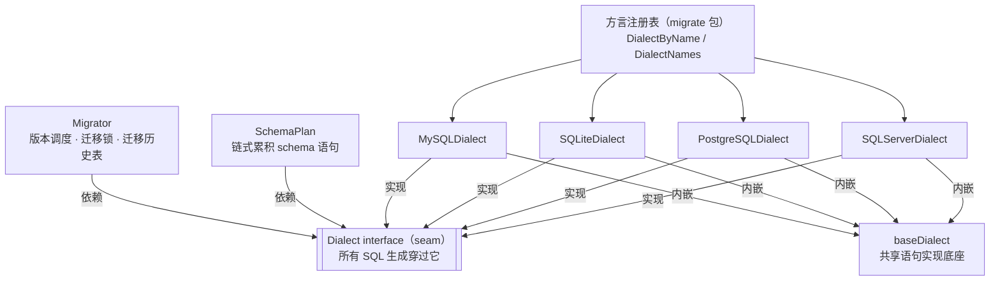
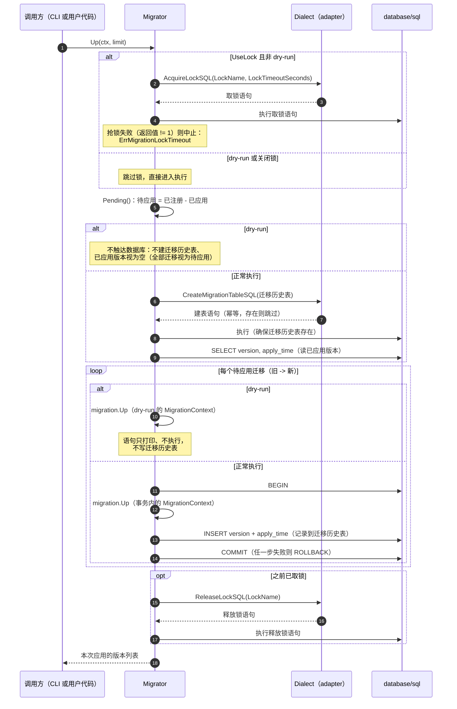
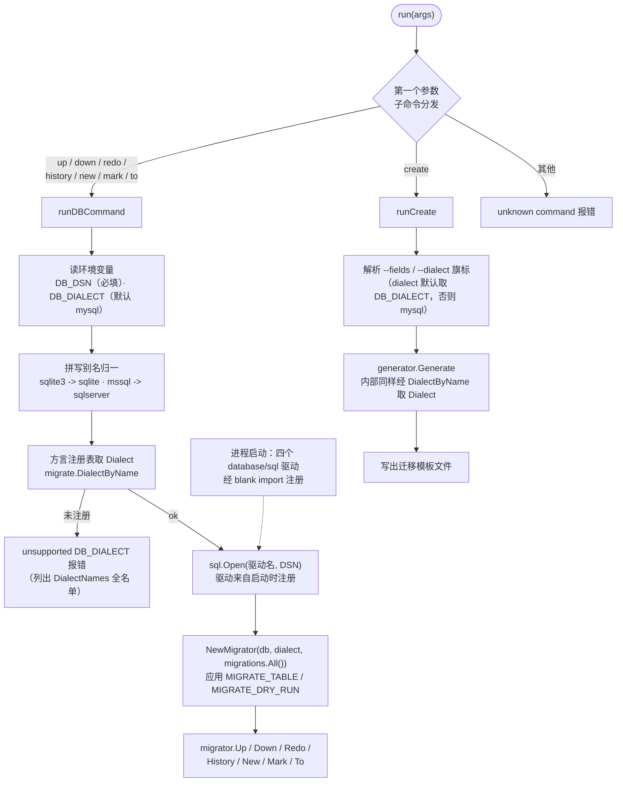

# 架构：模块关系与执行时序

本页面向想理解库结构的使用者，用三张图讲清三件事：模块之间怎么组合（seam 在哪）、一次 `migrate up` 在库内怎么执行（锁 -> 迁移历史表 -> 版本比对 -> 执行与记录）、CLI 怎么走进库。三张图的节点与连线均与 v0.1.0 源码逐一核对；API 用法不在本页展开（见[迁移编写指南](migrations.md)），只讲结构与其背后的设计意图。术语与仓库根目录 `CONTEXT.md` 词汇表一致。

## 模块图：Dialect seam 与组合关系

- **Dialect 是唯一的 seam**。Migrator 与 SchemaPlan 都不自己拼 SQL：语句生成都穿过 `Dialect` interface，执行则始终经 `database/sql` 完成——adapter 只产出语句文本，不碰连接，本库不引入 ORM。Migrator 执行每个迁移时构造 `MigrationContext`（携带同一个 Dialect 与当前事务），迁移代码经它取得 SchemaPlan，因此两个使用方落到的是同一个 seam。
- **迁移历史表是 Migrator 的领域概念**。表结构（version + apply_time）由 Migrator 决定，各数据库只负责翻译建表语法：mysql / sqlite / postgres 生成 `CREATE TABLE IF NOT EXISTS`，sqlserver 没有 `IF NOT EXISTS`，改为 `IF OBJECT_ID(...) IS NULL` 判存后建表。对调用方始终是同一句「确保历史表存在」。
- **内嵌组合，不是基类**。baseDialect 内嵌在四个 adapter 中，承载四方言一致的语句形状；adapter 只覆写真实分歧：类型映射、引号、存在性探针、迁移锁、注释、不支持项。因此新增一个方言 = 实现一个 adapter + 补一致性矩阵期望列 + 注册表登记，步骤见[方言参考 - 新增一个方言](dialects.md)。
- **方言注册表是方言知识的唯一入口**。`migrate` 包内 `name -> Dialect` 的不可变注册表，经 `DialectByName` / `DialectNames` 暴露；CLI 与迁移生成器都从这里取 Dialect（见下方流程图），不存在第二份方言名单。

## 时序图：一次 migrate up

与 `migrate/migrator.go` 的实际执行顺序一致。注意锁包裹整个执行段：建迁移历史表、读已应用版本、逐个执行迁移，全部在锁内完成。

- **锁语句由 Dialect 生成**：MySQL 用 `GET_LOCK` / `RELEASE_LOCK`，SQL Server 用 `sp_getapplock`，Migrator 只判断抢锁结果；dry-run 与显式关闭锁时整段跳过。
- **一个迁移一个事务**：`Up` 的语句与写入迁移历史表的 INSERT 在同一事务内提交，任一步失败整体回滚，历史表不会记录半次迁移（语义见[迁移编写指南 - 执行模型](migrations.md)）。
- **dry-run 分支**：不取锁、不建迁移历史表、已应用版本视为空（因此全部已注册迁移都会被重放展示），语句只打印、永不触达数据库。

## 流程图：CLI 到库的调用路径

与 `cmd/migrate/main.go` 一致。驱动注册与方言解析是两条独立的线：database/sql 驱动经 blank import 在进程启动时注册（main.go 顶部的四个驱动 import）；方言本体则始终经方言注册表取得。

- CLI 内的别名表只做拼写归一，把 `DB_DIALECT` 的各种写法映射到规范驱动名；方言本体永远来自 `DialectByName`，未注册的取值报错并列出 `DialectNames()` 的全名单。
- `create` 分支不连数据库：生成器内部同样经 `DialectByName` 取 Dialect，用其类型映射渲染模板——注册表被 CLI 与生成器共用的另一处体现。
- 八个子命令的旗标、环境变量与报错行为逐项见[CLI 参考](cli.md)。

## 三条贯穿的设计决定

1. **drop 一律严格**：adapter 层的删除类操作永不生成 `IF EXISTS`，对象不存在交给数据库自然报错——四个方言同一失败模式，不静默跳过。
2. **幂等只归 plan 层探针**：`*IfExists` 变体在发语句前先探测对象存在性，存在才跳过；幂等是 plan 层的概念，不依赖任何数据库的 SQL 特性。
3. **显式报 unsupported**：数据库给不了的操作返回 `UnsupportedOperationError`，未映射的列类型同样报错、不透传拼 SQL。

前两条的逐操作语义见[方言参考 - 图例与两条全局契约](dialects.md#legend)。

## 下一步

- [快速上手](getting-started.md)：从零跑通第一次迁移的完整闭环。
- [迁移编写指南](migrations.md)：ColumnBuilder、SchemaPlan 与查询 helper 的 API 主参考。
- [方言参考](dialects.md)：能力矩阵、各方言注意事项与新增方言指南。
- [CLI 参考](cli.md)：全部子命令、旗标、环境变量与报错行为。
