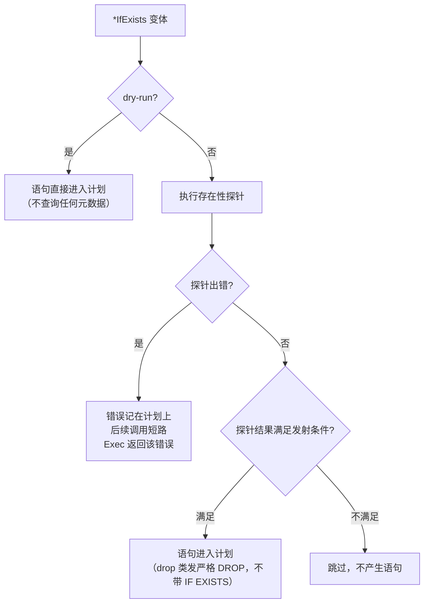

# 迁移编写指南

本页是写迁移时的 API 主参考：迁移的结构与注册、ColumnBuilder 列定义、SchemaPlan 链式操作（含 `*IfExists` 的存在性探针语义）、查询 helper、迁移锁与 dry-run。所有示例均与 v0.1.0 的实际 API 签名逐一核对过。

- 还没跑通过第一次迁移：先看[快速上手](getting-started.md)。
- 只想查 CLI 子命令、旗标与环境变量：看 [CLI 参考](cli.md)。
- 各方言能力差异、注意事项与新增方言：看[方言参考](dialects.md)。
- 导出 API 的逐项明细：看 [pkg.go.dev 文档](https://pkg.go.dev/github.com/phgors/yiimigrate/migrate)（模块路径 `github.com/phgors/yiimigrate`），本页不重复 godoc。

## 迁移的结构与注册

<a id="structure"></a>

一个迁移是实现了 [`Migration`](https://pkg.go.dev/github.com/phgors/yiimigrate/migrate#Migration) 接口的普通 Go 类型，三个方法：

```go
type Migration interface {
	Name() string
	Up(ctx context.Context, m *MigrationContext) error
	Down(ctx context.Context, m *MigrationContext) error
}
```

完整骨架（`ctx` 是命令传入的上下文；`m` 是库注入的 [`MigrationContext`](https://pkg.go.dev/github.com/phgors/yiimigrate/migrate#MigrationContext)，所有 helper 都挂在它上面）：

```go
package migrations

import (
	"context"

	"github.com/phgors/yiimigrate/migrate"
)

type M20260613_120000CreateArticleTable struct{}

func (M20260613_120000CreateArticleTable) Name() string {
	return "m20260613_120000_create_article_table"
}

func (M20260613_120000CreateArticleTable) Up(ctx context.Context, m *migrate.MigrationContext) error {
	return m.Schema().
		CreateTable("article", migrate.Columns().
			Add("id", m.UnsignedBigPrimaryKey()).
			Add("title", m.String(128).NotNull()),
			"ENGINE=InnoDB DEFAULT CHARSET=utf8mb4",
		).
		Exec(ctx)
}

func (M20260613_120000CreateArticleTable) Down(ctx context.Context, m *migrate.MigrationContext) error {
	return m.Schema().DropTable("article").Exec(ctx)
}
```

仓库内用 `go run ./cmd/migrate create` 生成这份骨架（用法见 [CLI 参考 - create](cli.md#create)）；外部项目直接照抄手写（见[快速上手 - 集成到自己的项目](getting-started.md#embed)）。

### Name 约定与执行顺序

`Name()` 返回的字符串就是迁移的版本号，同时扮演三个角色：

- **排序键**：[`NewMigrator`](https://pkg.go.dev/github.com/phgors/yiimigrate/migrate#NewMigrator) 在注册时按 `Name()` 的字典序排序，之后从旧到新应用——注册顺序不影响执行顺序。
- **迁移历史表里的 version**：应用成功后 `Name()` 连同 Unix 时间戳写入迁移历史表（表结构见[快速上手 第 5 步](getting-started.md)）。
- **身份标识**：每个迁移的 `Name()` 必须唯一，重名会让历史表判定与版本查找失去意义。

因此约定版本名内嵌时间戳：`m` + `YYYYMMDD_HHMMSS` + `_` + 小写蛇形描述（如 `m20260613_120000_create_article_table`），字典序恰好等于时间序。`create` 命令生成的文件名与类型名都遵守这个约定。

### 不可逆迁移

无法安全回滚的迁移，让 `Down` 返回 [`migrate.ErrIrreversibleMigration`](https://pkg.go.dev/github.com/phgors/yiimigrate/migrate#ErrIrreversibleMigration)：

```go
func (M20260701_090000DropLegacyTable) Down(ctx context.Context, m *migrate.MigrationContext) error {
	return migrate.ErrIrreversibleMigration
}
```

回滚（`down` / `redo` / `to`）碰到它时，事务回滚、命令以错误退出；`up` 照常应用，不受影响。

### 执行模型：每个迁移一个事务

非 dry-run 时，Migrator 为每个迁移开一个事务：`Up`（或 `Down`）执行成功后，在**同一事务里**写入（或删除）迁移历史表记录，然后提交。也就是说迁移代码看到的所有数据库操作——`SchemaPlan.Exec`、查询 helper、`m.Execute`——都走这一个事务，任一步出错则整个迁移回滚，历史表不受影响。

注意事务保证受数据库自身能力限制：例如 MySQL 的 DDL 会隐式提交，事务里的 DDL 出错时已执行的 DDL 无法回滚。

## ColumnBuilder：定义列

<a id="column-builder"></a>

列用 [`ColumnBuilder`](https://pkg.go.dev/github.com/phgors/yiimigrate/migrate#ColumnBuilder) 描述：先从 `MigrationContext` 上的类型构造器起步，再用修饰符链加工，最后交给 `migrate.Columns().Add(...)`。

### 列类型构造器

全部构造器都定义在 `*MigrationContext` 上（即 `m.Xxx()`），与 `column_builder.go` 一一对应：

| 分组 | 构造器 |
| --- | --- |
| 主键（自带自增） | `m.PrimaryKey()`、`m.BigPrimaryKey()`、`m.UnsignedPrimaryKey()`、`m.UnsignedBigPrimaryKey()` |
| 整型（均可带可选显示宽度，如 `m.Integer(11)`） | `m.TinyInteger(l...)`、`m.SmallInteger(l...)`、`m.Integer(l...)`、`m.BigInteger(l...)`，以及对应的 `m.UnsignedTinyInteger(l...)`、`m.UnsignedSmallInteger(l...)`、`m.UnsignedInteger(l...)`、`m.UnsignedBigInteger(l...)` |
| 字符串 | `m.String(size...)`（变长，省略 size 默认 255）、`m.Char(size)`（定长，size 必填）、`m.Text()`、`m.TinyText()`、`m.MediumText()`、`m.LongText()` |
| 二进制 | `m.Binary(l...)`、`m.TinyBlob()`、`m.MediumBlob()`、`m.LongBlob()` |
| 布尔 | `m.Boolean()` |
| 浮点与精确小数 | `m.Float(p...)`、`m.Double(p...)`、`m.Decimal(precision, scale)`、`m.Money(precision, scale)` |
| 日期时间 | `m.Date()`、`m.DateTime(p...)`、`m.Time(p...)`、`m.Timestamp(p...)`（p 为可选的秒精度） |
| 其他 | `m.Json()`、`m.UUID()`、`m.Enum(values...)`、`m.Set(values...)` |

```go
Add("status", m.UnsignedTinyInteger().NotNull().DefaultValue(10)).
Add("price", m.Decimal(10, 2).NotNull()).
Add("state", m.Enum("draft", "published", "archived").NotNull().DefaultValue("draft")).
Add("created_at", m.Timestamp(0).NotNull().DefaultExpression("CURRENT_TIMESTAMP"))
```

### 修饰符

每个修饰符都返回新的 builder 副本，可以任意组合：

| 修饰符 | 作用 |
| --- | --- |
| `.NotNull()` / `.Null()` | 显式声明 NOT NULL / NULL |
| `.Unsigned()` | 无符号（方言支持见[下文](#dialect-gaps)） |
| `.PrimaryKey()` | 标记为主键（隐含 NOT NULL） |
| `.AutoIncrement()` | 自增 |
| `.Unique()` | 唯一约束 |
| `.DefaultValue(v any)` | 字面量默认值 |
| `.DefaultExpression(sql string)` | SQL 表达式默认值（如 `"CURRENT_TIMESTAMP"`）；与 `.DefaultValue` 互斥，后设置的生效 |
| `.Comment(text string)` | 列注释 |
| `.Check(expr string)` | CHECK 约束表达式 |
| `.After(column string)` / `.First()` | 列位置（MySQL） |
| `.Append(sql string)` | 在列定义末尾追加原生 SQL 片段 |
| `.Charset(name string)` / `.Collate(name string)` | 字符集 / 排序规则（MySQL） |
| `.GeneratedAs(expr string)` | 生成列表达式，配合 `.Stored()` 或 `.Virtual()` 指定存储方式 |
| `.Nullable() bool` | 读取当前是否可空（查询方法，不是修饰符） |

关于可空性的一个细节：builder 初始是"未声明"状态，不调用 `.Null()` / `.NotNull()` 时生成的列定义**不带** NULL 子句，可空性由数据库默认决定（多数数据库默认可空）。`create` 生成器因此会为未声明的字段自动补一个显式 `.Null()`（见 [CLI 参考 - --fields](cli.md#fields)）。

### 不可变性

`ColumnBuilder` 是不可变的：每个修饰符都在副本上修改（`clone` 后返回新 builder），原 builder 永远不变。这让你可以安全地派生列：

```go
name := m.String(128)      // 未声明可空性的 VARCHAR(128)

title := name.NotNull()    // title 带 NOT NULL
slug := name.Unique()      // slug 只带 UNIQUE——title 的修改没有泄漏
```

同理，把同一个 builder 交给多个 `Add` 也不会互相影响。列的**顺序**由 `migrate.Columns().Add(...)` 的调用顺序决定（内部是有序列表），建表时列顺序就是 Add 顺序。

### 方言差异速查

<a id="dialect-gaps"></a>

构造器与修饰符是统一 API，各 adapter 落到自家 SQL 时有三类真实分歧，写跨方言迁移前值得过一眼：

| 能力 | mysql | postgres | sqlite | sqlserver |
| --- | --- | --- | --- | --- |
| `.Unsigned()` | 数值类型追加 `UNSIGNED`；非数值类型忽略 | 报不支持 | 忽略 | 报不支持 |
| `.Charset` / `.Collate` / `.After` / `.First` | 支持 | 报不支持 | —— | 报不支持 |
| `m.Enum(...)` / `m.Set(...)` | 原生 `ENUM(...)` / `SET(...)` | 落为 `TEXT`，取值列表不进 SQL | 落为 `TEXT`，取值列表不进 SQL | 报不支持 |

"报不支持"指生成语句时返回 `*UnsupportedOperationError`（如 `postgres does not support UNSIGNED`），在 dry-run 里同样会暴露——不依赖某个数据库时，用 dry-run 扫一遍就能提前发现。

上表是速览版；完整的操作 × 方言能力矩阵、四方言注意事项与「新增一个方言」扩展指南见[方言参考](dialects.md)。

## SchemaPlan：链式 schema 操作

<a id="schema-plan"></a>

`m.Schema()` 创建一个 [`SchemaPlan`](https://pkg.go.dev/github.com/phgors/yiimigrate/migrate#SchemaPlan)：链上的每个操作把生成的 SQL 语句**累积**进计划，最后 `Exec(ctx)` 按顺序执行。AGENTS 约定的目标风格：

```go
return m.Schema().
	CreateTableIfNotExists(ctx, "article", migrate.Columns().
		Add("id", m.UnsignedBigPrimaryKey()).
		Add("user_id", m.UnsignedBigInteger().NotNull()).
		Add("title", m.String(128).NotNull()).
		Add("content", m.LongText().Null()).
		Add("metadata", m.Json().Null()).
		Add("created_at", m.Timestamp(0).NotNull().DefaultExpression("CURRENT_TIMESTAMP")),
		"ENGINE=InnoDB DEFAULT CHARSET=utf8mb4",
	).
	CreateIndexIfNotExists(ctx, "idx-article-user_id", "article", []string{"user_id"}, false).
	Exec(ctx)
```

### 操作清单

全部链式方法（`*IfExists` 变体的 `ctx` 是第一个参数，供存在性探针使用）：

| 分组 | 方法 |
| --- | --- |
| 表 | `CreateTable(table, columns, options ...string)`、`CreateTableIfNotExists(ctx, ...)`、`DropTable(table)`、`DropTableIfExists(ctx, table)`、`RenameTable(old, new)`、`TruncateTable(table)` |
| 列 | `AddColumn(table, column, builder)`、`AddColumnIfNotExists(ctx, ...)`、`AlterColumn(table, column, builder)`、`DropColumn(table, column)`、`DropColumnIfExists(ctx, table, column)`、`RenameColumn(table, old, new)` |
| 索引 | `CreateIndex(name, table, columns []string, unique bool)`、`CreateIndexIfNotExists(ctx, ...)`、`DropIndex(name, table)`、`DropIndexIfExists(ctx, name, table)` |
| 主键 | `AddPrimaryKey(name, table, columns []string)`、`AddPrimaryKeyIfNotExists(ctx, ...)`、`DropPrimaryKey(name, table)`、`DropPrimaryKeyIfExists(ctx, name, table)` |
| 外键 | `AddForeignKey(name, table, columns, refTable, refColumns, onDelete, onUpdate)`、`AddForeignKeyIfNotExists(ctx, ...)`、`DropForeignKey(name, table)`、`DropForeignKeyIfExists(ctx, name, table)` |
| 注释 | `AddCommentOnColumn(table, column, comment)`、`DropCommentFromColumn(table, column)`、`AddCommentOnTable(table, comment)`、`DropCommentFromTable(table)` |
| 数据变更 | `Insert(table, Row)`、`BatchInsert(table, columns []string, rows [][]any)`、`Update(table, Row, condition, args...)`、`Delete(table, condition, args...)` |
| 原生 SQL | `Raw(sql string, args ...any)` |

说明：

- `CreateTable` 的 `options` 是变长字符串，生成时用空格拼接（惯用单个 `"ENGINE=InnoDB DEFAULT CHARSET=utf8mb4"`）。
- 外键动作用 [`ForeignKeyAction`](https://pkg.go.dev/github.com/phgors/yiimigrate/migrate#ForeignKeyAction) 常量：`migrate.Cascade`、`migrate.Restrict`、`migrate.SetNull`、`migrate.NoAction`。
- `Insert` / `Update` 的 `Row` 是 `map[string]any`；`condition` 是原样拼进 WHERE 的条件串，占位符 `?` 配合 `args` 绑定。

### `*IfExists` 与存在性探针

<a id="ifexists"></a>

十个 `*IfExists` 变体是本库唯一的幂等机制，实现是**执行前探针**，不是往 SQL 里塞 `IF EXISTS` 语法：

| 变体组 | 探针 |
| --- | --- |
| `CreateTableIfNotExists` / `DropTableIfExists` | `TableExists` |
| `AddColumnIfNotExists` / `DropColumnIfExists` | `ColumnExists` |
| `CreateIndexIfNotExists` / `DropIndexIfExists` | `IndexExists` |
| `AddPrimaryKeyIfNotExists` / `DropPrimaryKeyIfExists` | `ConstraintExists` |
| `AddForeignKeyIfNotExists` / `DropForeignKeyIfExists` | `ForeignKeyExists` |

判定逻辑（create 类要求对象**不存在**才发语句，drop 类要求对象**存在**才发语句）：



三种典型行为，逐一对应代码里的 `existenceGuard`：

- **dry-run 直发**：dry-run 模式下语句无条件进入计划，连元数据都不查——这样 dry-run 下计划里能看到与真实执行一致的完整语句，也省掉一类元数据查询。
- **已存在（或不存在）则跳过**：探针结果不满足发射条件时，这个操作不产生任何语句，计划继续。
- **探针出错记 err**：探针查询失败时错误记在计划上，之后的链式调用全部变成空操作，`Exec` 返回该错误。

一个已知边界：SQLite 没有命名约束的元数据可查，`ForeignKeyExists` / `ConstraintExists` 在 SQLite 上恒返回"不存在"——因此 `AddForeignKeyIfNotExists` 在 SQLite 上每次都会发语句，`DropForeignKeyIfExists` 永远跳过。

不带 `IfExists` 的基线操作（`DropTable`、`CreateIndex` 等）一律严格：对象不存在时由数据库报错。幂等只属于 plan 层的探针机制，adapter 层不提供宽容版删除。

### Raw、Statements() 与 Exec

- **`Raw(sql, args...)`**：把原生 SQL 原样追加进计划（args 作为绑定参数）。适合库没有覆盖的方言特性；MySQL 下执行多语句时 DSN 需加 `multiStatements=true`（见[快速上手 - 选择方言与 DSN](getting-started.md#dialect)）。
- **`Statements()`**：返回计划已累积语句的防御性拷贝（`[]SQLStatement`，每项含 `Query` 与 `Args`），主要供测试断言与 dry-run 检查使用；生产代码正常走 `Exec`。
- **`Exec(ctx)`**：按累积顺序逐条执行。计划上记过错误（生成失败或探针失败）则直接返回该错误、一条都不执行；dry-run 模式下不执行任何语句直接返回 nil。

另有一个不在计划里的执行出口：`m.Execute(ctx, query, args...)` 立即执行单条语句（dry-run 下同样跳过）。需要"排队"用 `Raw`，需要"现在就执行"用 `Execute`。

### 完整示例

仓库内的 [examples/migrations/m20260613_120000_create_article_table.go](../examples/migrations/m20260613_120000_create_article_table.go) 是一份可运行的完整范例：`RowExists` 数据分支 + `*IfExists` 幂等建表建索引建外键 + 带 `migrate.Expr` 的 `Insert`，`Down` 用三个 `*IfExists` 变体逆序清理。

## 查询 helper 与数据变更

<a id="query"></a>

迁移里经常需要读写数据（seed、条件变更、跨表搬运）。查询 helper 直接定义在 `MigrationContext` 上，**立即执行**，不进计划：

| 方法 | 语义 |
| --- | --- |
| `m.RowExists(ctx, table, condition, args...)` | 是否存在满足条件的行 |
| `m.CountRows(ctx, table, condition, args...)` | 满足条件的行数 |
| `m.QueryValue(ctx, query, args...)` | 首行首列的值，无行时返回 nil |
| `m.QueryOne(ctx, query, args...)` | 首行（`Row` 即 `map[string]any`），无行时返回 nil |
| `m.QueryAll(ctx, query, args...)` | 全部行 |
| `m.TableExists` / `ColumnExists` / `IndexExists` / `ForeignKeyExists` / `ConstraintExists` | 对象存在判断——正是 `*IfExists` 探针的实现底座，需要手写幂等逻辑时可直接复用 |

数据变更（`Insert` / `BatchInsert` / `Update` / `Delete`）是 SchemaPlan 的方法，随计划一起排队执行。条件分支 + seed 的惯用写法：

```go
exists, err := m.RowExists(ctx, "user", "username = ?", "admin")
if err != nil {
	return err
}

if !exists {
	return m.Schema().
		Insert("user", migrate.Row{
			"username":   "admin",
			"created_at": migrate.Expr("UNIX_TIMESTAMP()"),
		}).
		Exec(ctx)
}
```

`migrate.Expr(sql)` 把原生 SQL 表达式标记为"直拼不转义"，用于 DML 值位置（普通值会作为绑定参数传入）。SQL 函数如 `LOWER(email)` 一律走 `Expr` 或原样写进条件串，绝不会被当作列名去加引号。

两点行为提醒：

- **事务内**：Migrator 应用迁移时（见[执行模型](#structure)），查询 helper 走迁移自己的事务，能读到本迁移先前语句的未提交改动。
- **dry-run 不拦查询**：dry-run 只拦截"执行"（计划 Exec 与 `m.Execute`），SELECT 类查询照常打到数据库——用 `RowExists` 做数据分支时注意这一点。

## 迁移锁

<a id="lock"></a>

迁移锁是 Migrator 层概念：`Up` / `Down` / `Redo` / `To` / `Mark` 在整个执行期间持锁，防止并发迁移互相践踏。迁移代码本身不需要（也没有）任何加锁 API。

可调字段（`NewMigrator` 返回后设置，默认值即下列值）：

| 字段 | 默认 | 说明 |
| --- | --- | --- |
| `UseLock` | `true` | 是否取锁；dry-run 永不取锁 |
| `LockName` | `"yiimigrate"` | advisory lock 名 |
| `LockTimeoutSeconds` | `30` | 等锁秒数，超时报 `migration lock timeout` |

各方言的锁实现（MySQL `GET_LOCK`、PostgreSQL `pg_advisory_lock`、SQL Server `sp_getapplock`）见 [CLI 参考 - 迁移锁](cli.md#lock)。SQLite 没有 advisory lock，写操作命令直接报 `sqlite does not support ADVISORY LOCK`；内嵌使用时可设 `UseLock = false` 关闭（见[快速上手 - 集成到自己的项目](getting-started.md#embed)）。

## dry-run

<a id="dryrun"></a>

开启方式：CLI 设 `MIGRATE_DRY_RUN=1`（可用值见 [CLI 参考 - 环境变量](cli.md#env)），或内嵌时设 `Migrator.DryRun = true`。dry-run 对迁移代码的影响：

| 环节 | 行为 |
| --- | --- |
| 计划构建 | 照常：语句逐条生成，生成期错误（方言不支持的 `UnsupportedOperationError` 等）照常暴露 |
| `SchemaPlan.Exec` | 不执行任何语句，直接返回 nil |
| `*IfExists` 探针 | 短路：语句直发，不查元数据（见[上文](#ifexists)） |
| `m.Execute` | 跳过 |
| 查询 helper（SELECT） | 照常执行 |
| 历史表与锁 | 不写迁移历史表、不取迁移锁（Migrator 层行为，详见 [CLI 参考 - dry-run](cli.md)） |

想在 dry-run 里检查生成了什么语句，用 `plan.Statements()` 取累积结果——单元测试断言生成 SQL 也是走它。

## Yii2 到 Go API 对照

<a id="yii2-map"></a>

从 Yii2 迁移过来的开发者可以按这张表找对应写法：

| Yii2 | yiimigrate |
| --- | --- |
| `$this->createTable(...)` | `m.Schema().CreateTable(...)` |
| `$this->dropTable(...)` | `m.Schema().DropTable(...)` |
| `$this->addColumn(...)` | `m.Schema().AddColumn(...)` |
| `$this->dropColumn(...)` | `m.Schema().DropColumn(...)` |
| `$this->createIndex(...)` | `m.Schema().CreateIndex(...)` |
| `$this->addForeignKey(...)` | `m.Schema().AddForeignKey(...)` |
| `$this->insert(...)` | `m.Schema().Insert(...)` |
| `$this->batchInsert(...)` | `m.Schema().BatchInsert(...)` |
| `$this->update(...)` | `m.Schema().Update(...)` |
| `$this->delete(...)` | `m.Schema().Delete(...)` |
| `$this->execute(...)` | `m.Execute(...)`（立即执行）或 `m.Schema().Raw(...)`（排进计划） |
| `safeUp()` | `Up(ctx, m)`——每个迁移默认在自己的事务里执行 |
| `safeDown()` | `Down(ctx, m)`——事务语义同上 |

两点差异提醒：列声明从 PHP 数组换成不可变链式 `ColumnBuilder`（见[上文](#column-builder)）；幂等写法在 Yii2 里靠手写 `IF EXISTS` SQL，本库统一是 `*IfExists` 变体（见[上文](#ifexists)）。

## 下一步

- [快速上手](getting-started.md)：从零跑通第一次迁移的完整闭环。
- [方言参考](dialects.md)：能力矩阵、各方言注意事项与新增方言指南。
- [CLI 参考](cli.md)：全部子命令、旗标、环境变量与报错行为。
- [架构](architecture.md)：模块图、一次 migrate up 的执行时序与 CLI 调用流程。
- [排错指南](troubleshooting.md)：常见错误的「现象 -> 原因 -> 处置」目录与已知限制。
- [升级注意](upgrade-notes.md)：v0.1.0 行为变化的旧 / 新对照与迁移建议。
- [pkg.go.dev 文档](https://pkg.go.dev/github.com/phgors/yiimigrate/migrate)：`migrate` 包全部导出 API 的 godoc。
- [examples/migrations](../examples/migrations/m20260613_120000_create_article_table.go)：完整迁移范例。
