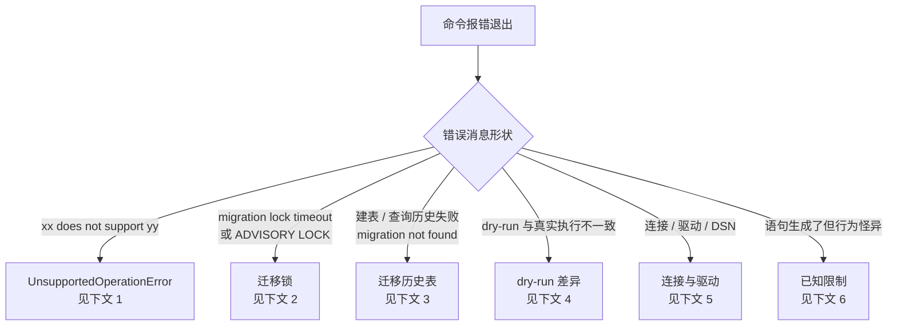

# 排错指南：常见错误与已知限制

本页按「现象 -> 原因 -> 处置」组织常见错误目录，错误消息原文均与 v0.1.0 的 `migrate` 包与 `cmd/migrate` 源码逐字核对。CLI 的用法 / 参数类报错（`usage:`、`unknown command` 等触发条件全表）见 [CLI 参考 - 退出与报错行为](cli.md#exit)，本页不重复，只展开运行期与数据库侧的错误。

- 命令怎么用、环境变量怎么设：[CLI 参考](cli.md)；第一次跑通见[快速上手](getting-started.md)。
- 迁移怎么写（`*IfExists` 探针、dry-run 语义）：[迁移编写指南](migrations.md)。
- 某方言到底支持什么：[方言参考 - 能力矩阵](dialects.md#matrix)。
- 从 v0.1.0 之前的开发快照升级：[升级注意](upgrade-notes.md)；版本历史见 [CHANGELOG](../CHANGELOG.md)。

## 先定位错误类型



## 1. UnsupportedOperationError 的读法与处置

<a id="unsupported"></a>

**现象**：生成语句时报错 `"<方言名> does not support <名称>"`（如 `sqlite does not support TRUNCATE TABLE`、`postgres does not support UNSIGNED`、`sqlserver does not support enum`），迁移在生成期停止，dry-run 下同样出现。

**原因**：这是 [`*UnsupportedOperationError`](https://pkg.go.dev/github.com/phgors/yiimigrate/migrate#UnsupportedOperationError)——数据库给不了的操作一律显式报错，绝不静默降级或透传拼 SQL。消息两个组成部分各有读法：

| 组成部分 | 取值 | 例子 |
| --- | --- | --- |
| 方言名 | 报错的 adapter 名（mysql / sqlite / postgres / sqlserver），即 `UnsupportedOperationError.Dialect` 字段 | `sqlite` |
| 名称 | **操作名**（大写短语，来自某个 Dialect 方法）：`TRUNCATE TABLE`、`ALTER COLUMN`、`ADVISORY LOCK`、`TABLE OPTIONS`、`UNSIGNED`、`COLUMN COMMENT`、`GENERATED AS`……或**类型名**（小写，来自列类型构造器）：`enum`、`set` 与未映射类型名，即 `Operation` 字段 | `does not support TRUNCATE TABLE` |

错误可用 `errors.As` 程序化识别，两个字段（`Dialect` / `Operation`）可直接读取；它实现了 error 接口，普通 `err.Error()` 输出就是上面的消息原文。

**处置**（三步，按序）：

1. **查矩阵确认**：这个操作在该方言是真的不支持，还是有怪癖的变体——[能力矩阵](dialects.md#matrix)里 `✗` 是报错、`⚠` 是支持但有细节。
2. **换等价操作**：多数 `✗` 有惯用替代。最大一块是 SQLite 的改表类操作（`ALTER COLUMN` / `DROP COLUMN` / `RENAME COLUMN` / `ADD PRIMARY KEY` / `ADD FOREIGN KEY`）——替代路径是「建新表 -> 搬数据 -> 删旧表 -> 改名」，见 [SQLite 注意事项](dialects.md#sqlite)；SQL Server 的 `enum` / `set` 用 `CHECK` 约束或参考表建模，`GENERATED AS`（计算列）用 `Raw`。
3. **`Raw` 兜底**：库没覆盖的方言特性用 [`Raw(sql, args...)`](migrations.md#schema-plan) 原样进计划；只需在列定义尾部拼片段时用 `.Append(sql)`。

提前暴露：这类错误在生成期即出现，`MIGRATE_DRY_RUN=1` 扫一遍全部迁移即可离线发现（见[迁移编写指南 - dry-run](migrations.md#dryrun)），不必等连上数据库。

## 2. 迁移锁

<a id="lock"></a>

写操作命令（`up` / `down` / `redo` / `mark` / `to`）默认整段持锁（锁名 `yiimigrate`、等待 30 秒，可调字段见 [迁移编写指南 - 迁移锁](migrations.md#lock)）。

### 2.1 `sqlite does not support ADVISORY LOCK`

**现象**：SQLite 下执行任何写操作命令，未开 dry-run 即报 `sqlite does not support ADVISORY LOCK`。

**原因**：SQLite 没有 advisory lock 机制，adapter 的 `AcquireLockSQL` / `ReleaseLockSQL` 直接返回 UnsupportedOperationError——不是环境问题，是能力缺失（见 [方言参考 - 迁移锁](dialects.md#matrix)）。

**处置**：两条路任选——`MIGRATE_DRY_RUN=1` 预览（dry-run 不取锁，见[下文 4](#dryrun)）；或按[快速上手 - 集成到自己的项目](getting-started.md#embed) 内嵌 `Migrator` 并设 `UseLock = false`（SQLite 单文件库通常靠文件锁串行，不需要应用层迁移锁）。

### 2.2 `migration lock timeout`

**现象**：命令启动后卡一段（默认 30 秒），报 `migration lock timeout` 退出，一条迁移都没跑。

**原因**：Migrator 的判定是「取锁语句的返回值不是 1」（`migrator.go` 的 `acquireLock`）——锁被另一个正在执行的迁移进程占着，等待超时。锁实现按方言：mysql `SELECT GET_LOCK(?, ?)`、sqlserver `sp_getapplock`（`@LockTimeout` 接超时），两者都会在超时后返回非 1。

**处置**：等持锁的进程跑完再重试；确认没有别的迁移进程时，排查是否有残留会话（见 2.3）。并发跑迁移的场景把 `LockTimeoutSeconds` 调大（CLI 固定 30 秒，内嵌可设）。

### 2.3 锁未释放 / 疑似锁残留

**现象**：迁移命令早已结束（或被强杀），下一次迁移仍报 `migration lock timeout`。

**原因**（按代码事实描述）：三种锁实现（`GET_LOCK`、`pg_advisory_lock`、`sp_getapplock`）都是**会话级**锁，随数据库会话（连接）生存。Migrator 的取锁与释放是**两条独立查询**，经 `*sql.DB` 连接池执行，不保证落在同一条连接上；释放查询的结果值只被 Scan、不被检查（`releaseLock`）——若释放语句恰好跑在别的会话上，它对别的会话持有的锁无效，也不报错。命令正常结束时通常无事；进程被强杀时，锁随连接断开由数据库回收。

**处置**：在数据库端结束持有锁的会话即可释放（如 MySQL `KILL <id>`、PostgreSQL `pg_terminate_backend`、SQL Server `KILL <spid>`）；同一个库里避免多进程并发迁移，或接受 `migration lock timeout` 作为串行信号。**已知限制**：Migrator 未提供把取锁 / 释放 / 迁移执行钉在同一条连接上的机制。

### 2.4 postgres 拿锁一直等，不报超时

**现象**：postgres 上锁被占时，命令无限期等待，`LockTimeoutSeconds`（以及 CLI 的 30 秒默认值）不生效。

**原因**（按代码事实描述）：postgres adapter 生成的取锁语句是 `SELECT pg_advisory_lock(hashtext($1))`——没有超时参数可用，`LockTimeoutSeconds` 在 postgres 上不参与任何语句；拿不到锁就一直等，除非 context 被取消，而 CLI 用的是 `context.Background()`（不会被取消）。

**处置**：靠外部超时兜底（如 `timeout` 命令包一层）；确保 postgres 上没有别的迁移进程持锁（锁名 `yiimigrate` 经 `hashtext` 折叠成 advisory key）。行为对照见 [PostgreSQL 注意事项](dialects.md#postgres)。

## 3. 迁移历史表

<a id="history-table"></a>

历史表（默认表名 `migration`，两列 `version varchar(180)` 主键 + `apply_time int`）由 Migrator 拥有，所有数据库命令在执行前自动确保它存在（[架构 - 迁移历史表](architecture.md)）。

### 3.1 第一个命令就报建表 SQL 错误

**现象**：`up` / `history` 等任何数据库命令在建表语句上报数据库错误（典型是权限类，如 MySQL 的 `CREATE command denied`）。

**原因**：自动建表不是后台魔法——命令执行前会真实执行建表语句：mysql / sqlite / postgres 生成 `CREATE TABLE IF NOT EXISTS ...`（已存在则跳过），sqlserver 生成 `IF OBJECT_ID(N'...', 'U') IS NULL BEGIN ... END` 判存后建表。当前数据库账号没有建表权限时，这一步原样失败。

**处置**：给账号授建表权限；或让 DBA 按同构 DDL 预建历史表（mysql 形态）：

```sql
CREATE TABLE IF NOT EXISTS migration (
  version varchar(180) NOT NULL PRIMARY KEY,
  apply_time int NOT NULL
)
```

### 3.2 自定义表名后迁移被整个重跑

**现象**：换了 `MIGRATE_TABLE`（或内嵌时改了 `MigrationTable`）之后，`up` 把所有已应用过的迁移重新执行，随即在建表 / 建索引上报「对象已存在」类数据库错误。

**原因**：版本记录在旧表名下，新表名是空历史 -> 所有已注册迁移都被判定为待执行 -> 逐个重放。这是严格契约的自然后果：不带 `IfExists` 的 `CreateTable` 不会静默跳过已存在的对象。

**处置**：全程固定同一个表名。确要换名时，先把旧表改名 / 把记录搬到新表，或用 `mark` 在新表名下重建基线（`mark <version>` 清空当前历史后按注册表写入到该版本为止，见 [CLI 参考 - mark](cli.md#commands)）。

### 3.3 `migration not found: <version>`

**现象**：`down` / `redo` / `to` / `mark` 报 `migration not found: m2026...`。

**原因**：历史表里有未注册的版本（迁移文件被删或 `Name()` 改名，`down` 逐条回滚时撞上），或 `to` / `mark` 的目标版本不在注册表里。

**处置**：恢复对应迁移的注册（把类型加回 `migrations.All()`）；确认要放弃该版本时，手工从历史表删除该行（`DELETE FROM migration WHERE version = '...'`）再重试；把已有 schema 的库纳入管理用 `mark`。

### 3.4 应用迁移时报主键冲突（duplicate / unique violation）

**现象**：`up` 执行到某条迁移的历史表写入时报重复键错误（如 MySQL `Duplicate entry 'm2026...' for key 'PRIMARY'`），事务回滚。

**原因**：两个迁移的 `Name()` 相同——`Name()` 既是排序键也是历史表 version 主键，重名会让第二条迁移的 INSERT 撞上第一条的记录（约定见[迁移编写指南 - Name 约定](migrations.md#structure)）。

**处置**：修正迁移名使全局唯一（时间戳约定天然防重），再重跑。

## 4. dry-run 与真实执行的差异

<a id="dryrun"></a>

dry-run（`MIGRATE_DRY_RUN=1` 或 `Migrator.DryRun = true`）拦截的是**执行**：不取锁、不建 / 写历史表、计划 `Exec` 与 `m.Execute` 直接跳过（全表见 [CLI 参考 - dry-run](cli.md) 与[迁移编写指南 - dry-run](migrations.md#dryrun)）。四个差异最常被误读：

### 4.1 dry-run 仍然连数据库、仍然可能报连接错误

**现象**：`MIGRATE_DRY_RUN=1 go run ./cmd/migrate up` 报连接错误（如 `dial tcp ...: connect: connection refused`）。

**原因**：dry-run 只拦「写」，SELECT 类查询照常执行——`m.RowExists` / `m.CountRows` / `m.QueryValue` 等查询 helper 直接打到数据库。迁移里只要有查询分支，dry-run 就需要一个可连的库。

**处置**：dry-run 时保证 `DB_DSN` 指向可连环境（查询只读不写，但查询引用的表必须存在——空库不一定够）；纯 schema 迁移（无查询 helper）才能完全离线 dry-run。

### 4.2 dry-run 展示的语句比真实执行多

**现象**：dry-run 输出 / `plan.Statements()` 里有 `CREATE TABLE`、`DROP INDEX` 等语句，真实执行却什么都没做（对象已存在 / 不存在，被跳过）。

**原因**：`*IfExists` 变体在 dry-run 下**短路探针、无条件发语句**（让你看到完整语句形状）；真实执行则先跑存在性探针，对象状态不满足就跳过（判定流程见[迁移编写指南 - `*IfExists`](migrations.md#ifexists)）。

**处置**：这是设计行为，不是不一致——用 dry-run 看「会生成什么语句」，用真实执行看「实际做了什么」。

### 4.3 dry-run 重放全部已注册迁移

**现象**：`MIGRATE_DRY_RUN=1 up` 输出的迁移比 `new` 列出的多——已经应用过的迁移也被「重放」。

**原因**：dry-run 不读历史表，已应用版本视为空，全部已注册迁移都按待执行处理（`Applied` 直接返回空）。

**处置**：无需处置；核对真实待执行清单用 `new`。

### 4.4 dry-run 通过不等于真实执行通过

**现象**：dry-run 全绿，真实 `up` 仍报错（权限不足、对象名冲突、约束违反……）。

**原因**：dry-run 下语句不触达数据库，数据库侧的一切校验（存在性、权限、语法接受度、数据约束）都没有发生；生成期错误（如 UnsupportedOperationError）才会在 dry-run 暴露。

**处置**：上线前在与生产同构的环境真实跑一遍。特别注意 MySQL：DDL 会隐式提交，迁移事务中途失败时已执行的 DDL **无法回滚**（见 [MySQL 注意事项](dialects.md#mysql)）——schema 可能残留半成品，重跑前把迁移写成 `*IfExists` 幂等形态最稳妥。

## 5. 连接与驱动

<a id="connection"></a>

### 5.1 `sql: unknown driver "..." (forgotten import?)`

**现象**：内嵌使用（自建入口 `sql.Open(...)`）时报 `sql: unknown driver "mysql" (forgotten import?)`（驱动名换成你传的那个）。

**原因**：`database/sql` 要求驱动包先经 blank import 注册进进程。CLI（`cmd/migrate`）已在顶部内置四个驱动，所以 CLI 不会遇到；自己写入口时要自己 import。

**处置**：按方言补 blank import，注意 `sql.Open` 的第一个参数是**驱动名**（modernc 的 sqlite 驱动名是 `sqlite`，不是 `sqlite3`——CLI 的别名表把 `sqlite3` 归一为 `sqlite`，自建入口没有这层归一）：

| 方言 | import | `sql.Open` 驱动名 |
| --- | --- | --- |
| mysql | `_ "github.com/go-sql-driver/mysql"` | `mysql` |
| postgres | `_ "github.com/lib/pq"` | `postgres` |
| sqlite | `_ "modernc.org/sqlite"` | `sqlite` |
| sqlserver | `_ "github.com/microsoft/go-mssqldb"` | `sqlserver` |

### 5.2 `DB_DSN is required` 与 `unsupported DB_DIALECT "..."`

**现象**：`DB_DSN is required`（未设连接串）；或 `unsupported DB_DIALECT "x"; supported values: mysql, postgres, sqlite, sqlserver`。

**原因**：数据库命令的前置检查——`DB_DSN` 必填；`DB_DIALECT` 必须落在别名表内（含 `postgresql` / `sqlite3` / `mssql` 别名，不区分大小写、忽略首尾空白）。全部触发条件见 [CLI 参考 - 退出与报错行为](cli.md#exit)。

**处置**：对照 [快速上手 - 选择方言与 DSN](getting-started.md#dialect) 设置两个变量；注意 `create --dialect` 只接受规范名（别名会报 `unknown dialect "..."`）。

### 5.3 DSN 语法 / 连接参数错误

**现象**：报错来自驱动本身（如 MySQL 驱动的 DSN 解析错误、`sqlserver://` 格式错误），或 MySQL 迁移里 `Raw` 执行多语句时失败。

**原因**：DSN 格式由各方言驱动定义并校验，报错原文直接透传驱动信息；go-sql-driver 默认一条连接一次只跑一条语句。

**处置**：对照 [DSN 示例表](getting-started.md#dialect)；MySQL 下用 `Raw` 执行多语句时 DSN 加 `multiStatements=true`。

## 6. 已知限制（不报错但行为有怪癖）

<a id="known-limits"></a>

以下条目**不会**报 UnsupportedOperationError——语句照常生成，但结果与直觉有距离。逐项详情与示例见 [方言参考 - 各方言注意事项](dialects.md#notes)，此表是速查：

| 现象 | 方言 | 原因摘要 | 处置 |
| --- | --- | --- | --- |
| 建表后列没有变成主键（无报错） | postgres | 非串行主键（如 `m.UUID().PrimaryKey()`）只渲染类型，`PRIMARY KEY` 静默丢失 | 建表后 `AddPrimaryKey`，或改用串行主键 |
| `.Comment()` 修饰符没落库（无报错） | postgres / sqlserver | 注释走独立语句，修饰符在 `CreateTable` / `AddColumn` 里渲染为空 | 用 `AddCommentOnColumn` / `AddCommentOnTable` |
| `AlterColumn` 后可空性 / 默认值没变 | postgres | 只生成改类型语句，其余修饰符静默丢弃 | `Raw` 补 `SET NOT NULL` / `SET DEFAULT` |
| 主键列变成 `INTEGER PRIMARY KEY AUTOINCREMENT`，声明的类型与修饰符丢了 | sqlite | 主键列折叠为固定形式 | 按整数主键设计，或 `.Append()` 拼片段 |
| `DropForeignKeyIfExists` / `DropPrimaryKeyIfExists` 永远不执行 | sqlite | 约束探针恒返回「不存在」（无命名约束元数据可查） | SQLite 上约束增删的基线操作本就报不支持；改约束走重建表路径，外键写进建表语句 |
| `AddPrimaryKeyIfNotExists` 每次都发语句、`DropPrimaryKeyIfExists` 永远跳过 | sqlserver | `ConstraintExists` 只查 `sys.check_constraints`，主键约束名不在其中 | 重复添加由数据库严格错误兜底；删除用基线 `DropPrimaryKey` |
| `m.Binary()` 不带尺寸生成裸 `VARBINARY` | mysql / sqlserver | 无默认宽度 | 建表前显式传尺寸 `m.Binary(n)` |
| `m.Enum(...)` / `m.Set(...)` 落库后没有取值约束 | postgres / sqlite | 落为 `TEXT`，取值列表不进 SQL | 自己加 `.Check(...)`；postgres 原生枚举可用 `Raw` |
| `DropPrimaryKey` 传了自定义约束名没生效 | mysql | 生成 `DROP PRIMARY KEY`，`name` 参数不进 SQL | MySQL 按约束种类定位主键，无需约束名 |

## 下一步

- [快速上手](getting-started.md)：从零跑通第一次迁移的完整闭环。
- [迁移编写指南](migrations.md)：ColumnBuilder、SchemaPlan 与查询 helper 的 API 主参考。
- [方言参考](dialects.md)：能力矩阵、各方言注意事项与新增方言指南。
- [CLI 参考](cli.md)：全部子命令、旗标、环境变量与报错行为。
- [架构](architecture.md)：模块图、一次 migrate up 的执行时序与 CLI 调用流程。
- [升级注意](upgrade-notes.md)：v0.1.0 三处行为变化的旧 / 新对照与改法。
- [CHANGELOG](../CHANGELOG.md)：按版本归档的变更历史。
